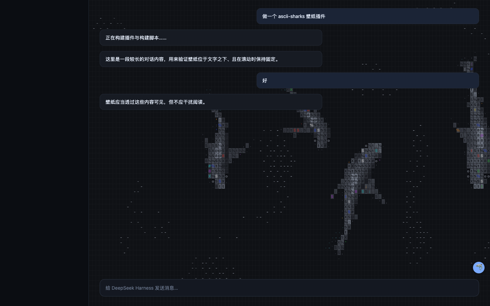
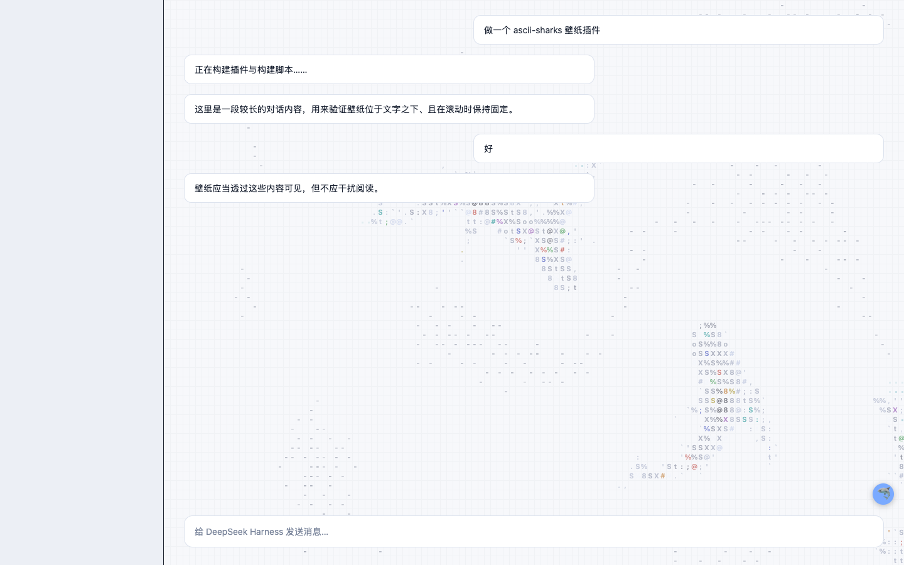
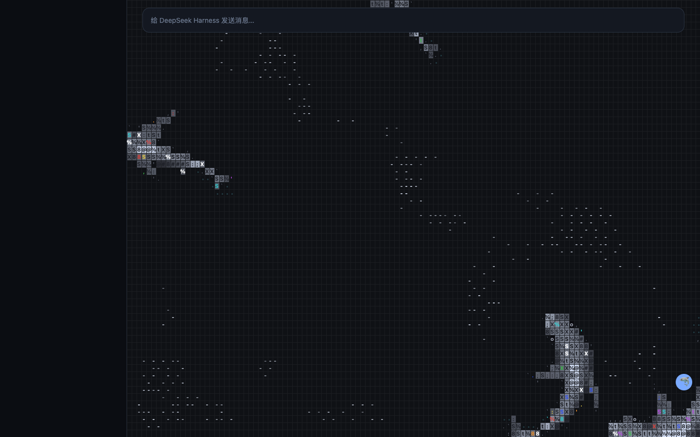
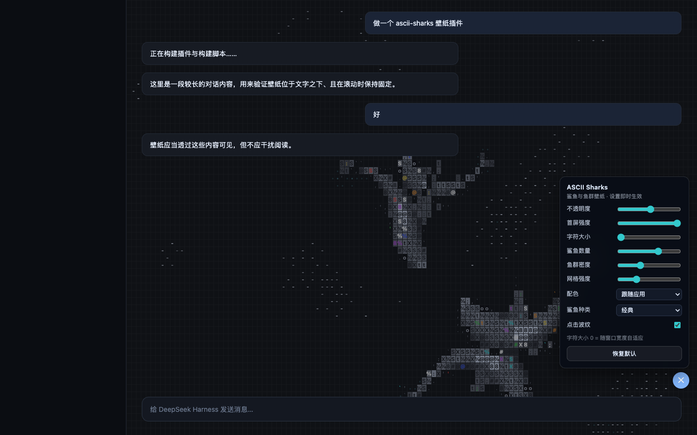

<div align="center">

# ASCII Sharks

**鲨鱼与鱼群，用 ASCII 字符画在对话区背景里游动。**

A DeepSeek Harness wallpaper plugin, ported from
[stackedlol/ascii-sharks](https://github.com/stackedlol/ascii-sharks).

`dsh-ascii-sharks` v0.1.4 · [HuasionWu/dsh-ascii-sharks](https://github.com/HuasionWu/dsh-ascii-sharks)

</div>



---

## 它是什么

`dsh-ascii-sharks` 把 [ascii-sharks](https://github.com/stackedlol/ascii-sharks)
的 canvas 动画接到 DeepSeek Harness 的对话列（`_centerCol`）背后：四条鲨鱼带着
成群的沙丁鱼、鳀鱼、银汉鱼在洋流里巡游，鱼群被鲨鱼惊散、重新聚拢，水面的点阵随
波光闪动。它是一张壁纸，不是消息流里的一个小部件——不占布局、不吃点击、不抢焦点。

- **透明叠层**：画布只画墨，宿主自己的背景色透上来，深浅主题都成立。
- **零运行时依赖**：React 由宿主提供，包内只有一份构建好的 `lib/client.js`。
- **首屏淡入**：新会话空态（hero）下满强度，进入对话后自动降到"若有若无"。
- **可调**：蓝色 🦈 按钮（与发送按钮同尺寸同配色）打开设置面板，改完立即生效并写入 `localStorage`。
- **可拖动**：按住 🦈 拖动即可把它放到任意位置，松手后记住坐标；拖到屏幕边缘会自动收回视野内，重启后仍在你放的地方。

## 安装

```bash
dsh plugin --profile desktop add dsh-ascii-sharks
```

或者从源码装：

```bash
git clone https://github.com/HuasionWu/dsh-ascii-sharks.git
cd dsh-ascii-sharks
npm install
npm run build
dsh plugin --profile desktop add .
```

> `desktop` 这个 profile 由 Electron 应用独占，命令行改不动它。若遇到
> `profile "desktop" is managed exclusively by the Electron application`，
> 请在应用内的插件市场里添加，或换一个 profile（如 `dsh plugin --profile web add .`）。

装好后重启 `dsh web`，打开任意会话即可看到背景。设置面板在对话区右下角。

| 浅色主题 | 空态满强度 | 设置面板 |
| --- | --- | --- |
|  |  |  |

## 设置

| 项 | 默认 | 说明 |
| --- | --- | --- |
| 不透明度 | `0.55` | 对话进行中的壁纸强度 |
| 首屏强度 | `1` | 新会话空态下的强度 |
| 字符大小 | `0` | `0` = 按列宽自适应（8–13px） |
| 鲨鱼数量 | `4` | 1–8 条，尺寸依次递减 |
| 鱼群密度 | `1` | 面积基准鱼数的倍率（0.2–2） |
| 网格强度 | `0.055` | 点阵网格的透明度 |
| 配色 | 跟随应用 | 深色 / 浅色 / 跟随宿主背景自动判断 |
| 鲨鱼种类 | 经典 | 经典、锤头、斑马、虎鲨、大锤头、灰鲭、长尾、护士鲨 |
| 点击波纹 | 开 | 点击背景时激起水花、惊散鱼群 |

设置存放在 `localStorage["dsh-ascii-sharks/settings/v1"]`；清掉即可恢复默认。

## 鲨鱼种类

上游的八种轮廓全部保留，每种都有自己的鳍形、体宽与体色：

`classic` 经典 · `hammerhead` 锤头 · `zebra` 斑马 · `tiger` 虎鲨 ·
`greathammer` 大锤头 · `mako` 灰鲭 · `thresher` 长尾 · `nurse` 护士鲨

## 开发

```bash
npm install
npm run check     # tsc --noEmit + 打包
npm run harness   # http://127.0.0.1:8931/harness/index.html
```

`harness/index.html` 是一个假的 DSH 外壳：它伪造 `window.__ModuleLoader__`、
`require` 与 `ctx.slots`，加载真实的 `lib/client.js`，再像宿主一样把组件挂进对话列。
支持两个查询参数：

- `?theme=light` — 浅色外壳，用来验证自动主题检测；
- `?hero=1` — 隐藏对话内容，用来验证空态强度。

构建产物 `lib/client.js` 必须提交：宿主直接加载它，安装时不会跑构建。

### 结构

```
src/
  math.ts       向量、噪声与无散度海流
  species.ts    五种小鱼的游动参数
  world.ts      空间哈希 boids、鲨鱼骨架、捕食与重生
  renderer.ts   ASCII 光栅化：轮廓、鳍、条纹、点阵、尾迹
  engine.ts     固定步长循环、尺寸、指针、可见性与减弱动效
  theme.ts      深/浅色调色板与主题探测
  settings.ts   设置模型、持久化与鲨鱼名册
  tuner.ts      纯 DOM 设置面板
  client.ts     DSH 客户端入口：插槽注册、宿主定位、壁纸挂载
index.js        宿主入口（无宿主逻辑，仅提供 Loader 条目）
cordis.patch.yml  插件注册补丁
```

## 与上游的差异

- 画布改为透明（上游画不透明白底），颜色改由调色板驱动，新增浅色主题。
- 引擎不再自己决定尺寸与生命周期，改由壁纸宿主跟随对话列。
- 新增设置模型、设置面板与 DSH 打包。

原始版权与修改说明见 [NOTICE](NOTICE)。

## License

[MIT](LICENSE) — 上游 `ascii-sharks` 未附授权文件，此处按原样保留署名与修改说明。
